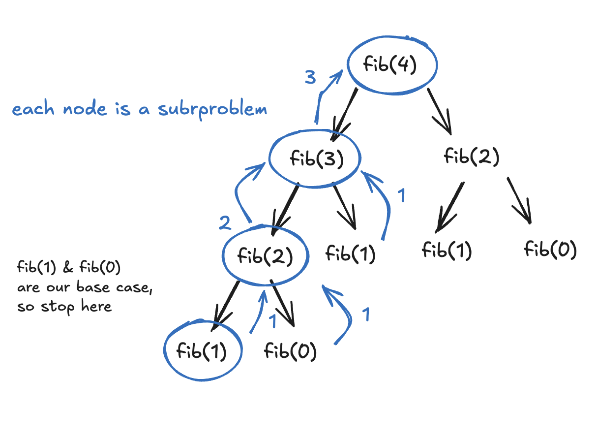
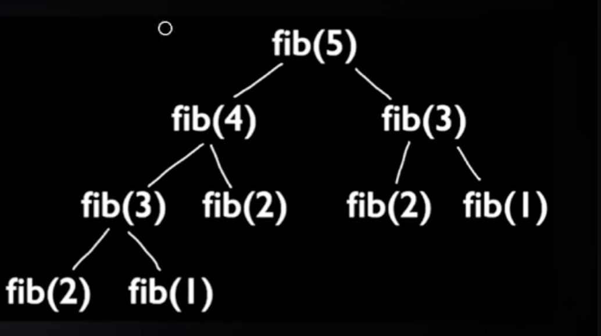
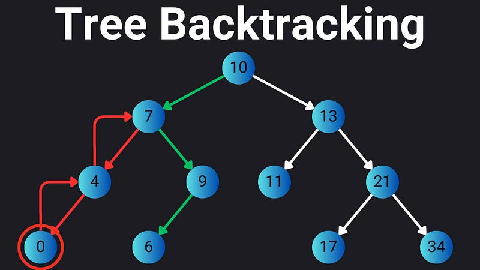
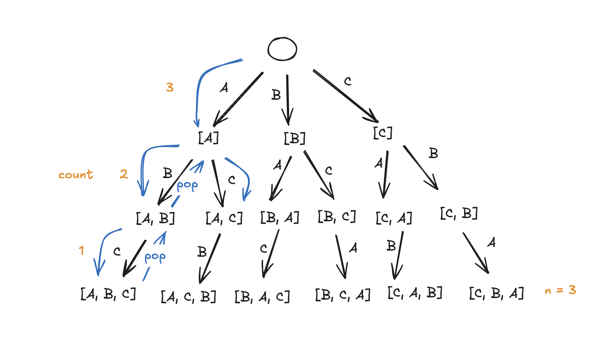
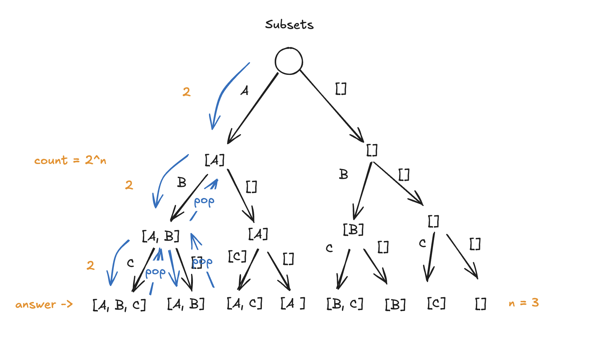
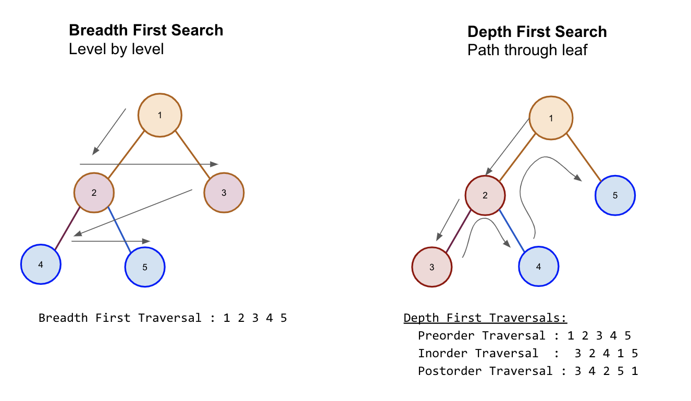

# Sorting

### Built in

```python
# In place, only accepts list objects
numbers = [5, 2, 9, 1]
numbers.sort()
print(numbers)
numbers.sort(reverse=True)
print(numbers)

# Returns new list, accepts any iterables
numbers = (5, 2, 9, 1)
sortedList = sorted(numbers)
print(sortedList)
reverse = sorted(numbers, reverse=True)
print(reverse)

# Sort based on key using lamda
students = [("Bob", 20), ("Alice", 22), ("John", 19)]
students.sort(key=lambda student: student[1])  # sort based on age
print(students)
```

### MergeSort

1. Divide: Recursively split the array into two halves until left with single elements
2. Conquer: Merge each halve into a single sorted array

```python
def merge(left: list[int], right: list[int]):
    # merge left and right arrays
    # compare current value of each and merge the smaller value
    i = 0
    j = 0
    result = []

    while i < len(left) and j < len(right):
        if left[i] <= right[j]:
            result.append(left[i])
            i += 1
        else:
            result.append(right[j])
            j += 1

    # append any remaining items from both arrays
    while i < len(left):
        result.append(left[i])
        i += 1
    while j < len(right):
        result.append(right[j])
        j += 1
    return result


def merge_sort(arr: list[int]):
    # 1. divide
    # base case
    if len(arr) <= 1:
        return arr

    mid = len(arr) // 2

    left = merge_sort(arr[0:mid])
    right = merge_sort(arr[mid : len(arr)])
    # 2. merge
    return merge(left, right)


arr = [1, 5, 4, 3, 2]
print(merge_sort(arr))
```

---


# Binary Search

1. Start with low index(0) and high index(len(list) -1)
2. Loop until low <= high
3. Check if middle value(low + high/2) < or > target, assign low and high to the respective left or right side

```python
# must be sorted first!
numbers = [2, 4, 6, 8, 10, 12]


def binary_search(numbers, target):
    left = 0
    right = len(numbers) - 1

    while left <= right:
        mid = (right + left) // 2
        midValue = numbers[mid]
        # found it
        if target == midValue:
            return mid
        # exists in left subarray
        if target <= midValue:
            right = mid - 1
        # exists in right subarray
        else:
            left = mid + 1
    # not found
    return -1


print(binary_search(numbers, 12))
```

---


# Hashing

Gives you very fast lookup, insertion, and deletion. 
Takes a piece of data, called a *key*, and converts it into an integer using a **hash function**. The integer determines where the data should be stored. 

```markdown
Key → Hash Function → Index → Value
```

```python
index = hash(key) % tableSize
```


### Two Types

**HashMap**: Store key, value pairs.

**HashSet**: Store unique values.

### What problem pattern signals that algorithm

- Do I need to quickly determine whether I've seen something before?
- Do I need to associate one thing with another?
- Do I need to count occurrences?
- Do I need to quickly look up a value?

---


# Recursion

Think of recursion as breaking a problem into smaller subproblems.
Each recursive call receives arguments that define the subproblem it needs to solve.
Each call performs some work, makes recursive calls, and/or returns a result.
A recursive call can use the return value of a smaller subproblem to solve its own problem.
Each call has its own distinct state: its arguments, local variables, and position in the call stack.

**VISUALIZE IT LIKE A TREE WHERE EACH NODE IS A SUBPROBLEM. THINK ABOUT WHAT EACH SUBPROBLEM IS TRYING TO SOLVE. For a single recursion call at a time, visualize it has a tree with one child.** 



1. Define the subproblem. What does one call of this function represent?
2. Identify the base case. When can the call answer immediately?
  Think from the bottom -> up
3. Does the call need information passed down from its parent?
4. Does it need answers returned from its children?
5. Does it need both?
6. Write the recursive step. Decide how smaller calls help solve the current call.

Every recursion problem is -> 

base case -> stopping condition

do something with current input -> return a value to the parent or don't

explore paths

```markdown
BASE CASE
    ↓
stop

RECURSIVE CASE
    ↓
solve smaller problem
```


### Problem pattern signals

- Can I solve this problem by solving a smaller version of the same problem?
- If you're given a tree, immediately consider DFS/recursion.
- Nested structures. You don't know how deeply nested it is.
- The problem asks you to explore all possibilities.

```python
# Fib
# each succeeding number is the sum of the two previous numbers
def fib(n: int):
    # 1. Define base case
    if n == 0:
        return 0
    if n == 1:
        return 1
    # 2. Break down into subproblems
    # 3. Return the combined solution
    return fib(n - 2) + fib(n - 1)


print(fib(10))
```

---


# Two Pointers

Use two indexes/pointers to move through a data structure, instead of repeadetly scanning elements. 
The goal is often to reduce O(n^2) -> O(n); move the pointers forward so they don't repeadedly revisit elements. 

### Need to ask

```markdown
What does each pointer represent?
What information do I know because of the current pointers?
When can I safely move left?
When can I safely move right?
Why can't moving that pointer eliminate a valid answer?
```


### Setup

```
[1, 2, 3, 4, 5, 6]
 ↑              ↑
left          right
```

**1. You maintain two positions:**

```python
left = 0
right = len(nums) - 1
```

**2. Then move one or both pointers based on some condition.**

```python
while left < right:
    # examine nums[left] and nums[right]
    if some_condition:
        left += 1
    else:
        right -= 1
```


### Types of pointers

- Opposite direction: Pointers start at opposite ends and then move in opposite directions.
- Same Direction: Pointers start at the beginning and then move in the same direction.
- Multiple Arrays: One pointer is assigned to each individual array to compare, merge, or find intersections (e.g., merging two sorted lists)
- In all cases the pointers could move at the same or different speeds.


### Problem clues

**Sorted Array**

- Find two numbers that...
- Find a pair...
- Closest pair...
- Target sum...

Think: Can I start at both ends and eliminate possibilities? 

**Strings**

- Reverse something..
- Compare beginning and end...
- Is this a palindrome...

Think: Left + Right pointers

**Removing/filtering elements**

- Remove duplicates
- Move zeros
- Partition array
- Keep certain elements

Think: Slow + fast pointers

**Comparing two sequences**

- Merge two sorted arrays
- Find intersection
- Compare two strings

Think: One pointer per sequence

```python
# Two Sum II (no added space compexity) - Opposite Directions

# Remove Duplicates - Same Direction
def removeDuplicates(nums):
    if not nums:
        return 0

    l = 0

    for r in range(1, len(nums)):
        if nums[r] != nums[l]:
            l += 1
            nums[l] = nums[r]

    return l + 1
```

---


# Sliding Window

Track or analyze a continuous sub-range (a subarray or substring) of data.

```markdown
[  2  1  5  1  3  2  ]
   L--------R
```


### Two Pointers vs. Sliding Window

```markdown
Two pointers = two positions that move according to some rule.
Sliding window = two pointers defining a continuously maintained range.
```


### Two types

1. Fixed-Size Window: The size of the window is predefined and never changes. You just slide it from the beginning of the array to the end.
  1. Initialize starting range
  2. Expand right, shrink left
  3. Record answer
  4. Repeat

```text
for right:
    add right

    if window size > k:
        remove left
        left++

    update answer
```

1. Dynamic (Variable-Size) Window: The size of the window grows or shrinks dynamically based on a condition.
  - The right pointer *grows* the window to take in new elements, and if a rule is broken, the left pointer *shrinks* the window until the condition is valid again.
  1. Expand right
  2. Check condition
  3. Shrink left until condition is valid
  4. Record answer
  5. Repeat

```text
left = 0

for right:
    expand window

    while window is invalid:
        shrink window from left

    update answer
```


### What problem pattern signals that algorithm

- "subarray"
- "contiguous"
- "consecutive"
- "maximum/minimum sum"
- "longest subarray"
- "shortest subarray"
- "contains at most K..."
- "without repeating characters"

```python
# Fixed - Maximum Average Subarray I
def findMaxAverage(nums: list[int], k: int) -> float:
    window_sum = sum(nums[:k])  # fill in the starting range
    max_sum = window_sum

    for i in range(k, len(nums)):
        window_sum = (
            window_sum - nums[i - k] + nums[i]
        )  # Use i + k as right pointer, shrink left and expand right by 1
        max_sum = max(max_sum, window_sum)  # Record answer

    return max_sum / k


# Dynamic - Longest Substring Without Repeating Characters
# redo this!
def lengthOfLongestSubstring(s):
    l = 0
    r = 0
    char_set = set()
    max_length = 0

    while r < len(s):
        while s[r] in char_set:
            set.remove(s[r])
            l += 1

        set.add(s[r])
        max_length = max(max_length, len(set))
        r += 1

    return max
```

---


# Greedy

Solves a problem by making the best-looking choice at each step without reconsidering previous decisions, hoping that these local choices lead to the best overall solution. 

## Greedy Problem Structure

- Greedy Choice Property: The optimal solution can be constructed by making the best local choice at each stop.
- Optimal Substructure: the optimal solution contains the optimal solutions to its sub-problems.

1. Iterate through the input
2. Identify the available choices at this step
3. Select the locally best choice using a rule
4. Commit to the choice, don't backtrack or reconside earlier choices
5. Stop when the problem's goal is reached

It usually involves sorting first, so we get the next optimal choice quickly. 

> **WARNING**
>
> Be careful with using Greedy, usually DP provides the best solution. So make sure to run an example to see if Greedy is valid. 
>
> An example is with the "Coin Change" problem. 
>
> [1, 3, 4, 5], amount = 7
>
> Greedy Algorithm would select 5 since it is the largest, and then two 1 coins => 3 coins total
>
> DP would break down the problem into subproblems for each amount, selecting the 3 and 4 coins => 2 coins total 


### Difference between Greedy and standard problem

There is still a decision at every step, but making decisions does not automatically make an algorithm greedy.

## Problem clues

- Maximize the number of activities
- Minimize the resources needed
- Select the largest/smallest available options
- Schedule non-overlapping intervals
- Reach destination with a constraint
- Build a minimum cost netwrok

```python
# Assign Cookies
# Use two pointer + Greedy
# The "Greedy choice" is to select the smallest cookie that satisfies a child, so sort both inputs in ascending order
def findContentChildren(g: list[int], s: list[int]) -> int:
    g.sort()
    s.sort()
    count = 0
    k = 0
    c = 0

    while c < len(s) and k < len(g):
        if s[c] >= g[k]:
            count += 1
            k += 1
        c += 1

    return count


# Non-Overlapping Intervals
# Use two pointer + greedy
# The "Greedy choice" is to add to count if curr.endtime > next.starttime
def eraseOverlapIntervals(intervals: list[list[int]]) -> int:
    intervals.sort(key=lambda a: a[1])
    count = 0
    l = 0
    r = 1

    while r < len(intervals):
        if intervals[l][1] > intervals[r][0]:
            count += 1
        else:
            l = r
        r += 1

    return count
```

---


# [Dynamic Programming](https://www.youtube.com/watch?v=bPbuCAzzmUs)

Solve complex problems by breaking them down into simpler subproblems, solving each subproblem exactly once, and storing their results to avoid *repeated* calculations. 

It's dynamic since you can't consider local best choices(Greedy) and you have to take into account all possible solutions at every step.

### Exmample Fibonacci



The overlap results in O(2^n)!

There are two ways we can optimize this with DP-> 

### Top-down DP (memoization)

Using recursion while caching the results. 

1. You start with the original problem and break it *down* into smaller problems.
2. Whenever you solve a subproblem, you store its result.
3. If you encounter that subproblem again, then you return the cached result.

Best suited for naturally recursive problems.

```python
memo = [None] * (n + 1)  # index 0 unused; memo[i] = fib(i)


def fib_top_down(n, memo):
    if memo[n] is not None:
        return memo[n]
    if n == 1 or n == 2:
        memo[n] = 1
        return 1
    memo[n] = fib(n - 2, memo) + fib(n - 1, memo)
    return memo[n]
```

Now we get O(2n + 1) * O(1) => O(n)!

### Bottom-up DP (tabulation)

Linearly complete the solution starting with the known subproblem solution. 

1. Start with smallest subproblems and add it to the DS.
2. Linearly iterate through the result using the previous subproblem solutions.

Best suited for problems with clear build-up order. 

```python
def fib_bottom_up(n):
    if n == 1 or n == 2:
        return 1

    bottom_up = [None] * (n + 1)
    bottom_up[1] = 1
    bottom_up[2] = 1
    for i in range(3, n + 1):
        bottom_up[i] = bottom_up[i - 1] + bottom_up[i - 2]
    return bottom_up[n]
```

Now we get O(n) * O(1) => O(n)!

## Steps to solve

Problem: Given a list of coin denominations, what is the minimum number of coins needed to make a target amount?

```
nums = [2, 7, 9, 3, 1]
```

1. Define the state

What information do I need to describe a smaller version fo the problem? 

```
dp[a] = minimum coins needed to make amount a
```

1. Identify the base cases

What is the smallest subproblems whose answers I already know? 

```
dp[0] = 0
```

1. Derive the recurrence relation

How can I calculate the current state using previously solved states? 

```
dp[a] = min(dp[a - coin] + 1)
```

1. Implement the solution

Choose `top down` or `bottom up` approach 

## Problem Clues

- Find the minimum/maximum/longest/shortest
  - You need the best possible solution among multiple choices (dynamic)
  - subsequence vs substring
- Count the number of ways
- Determine whether a target sum is possible
- Choose items subject to a capacity
- Make a decision at each position
- Answer depenends on previous positions

```
# Coin Change
```


# DP Algorithms


## Kadane's Algorithm

---


# DP vs. Greedy

Both build an answer step by step. The difference is whether a **local rule** is enough, or you must **compare all choices** using smaller subproblems.


|              | Greedy                                | Dynamic programming                           |
| ------------ | ------------------------------------- | --------------------------------------------- |
| Decision     | Take the best-looking option *now*    | Try every valid choice; keep the best overall |
| Memory       | Usually none (or a pointer / counter) | Table of subproblem answers (`dp[...]`)       |
| Typical cost | Often `O(n log n)` after sort         | Often `O(n · states)`                         |


**When greedy is enough:** the problem has the *greedy choice property* (a local optimum leads to a global optimum). Interval scheduling and "assign cookies" are standard examples.

**When you need DP:** several options look good locally, and the best overall mix depends on **which sub-amounts** you already solved. Minimum coin count is the usual counterexample.

### Same problem, two approaches — minimum coins

**Problem:** fewest coins to make `amount` using unlimited coins of each denomination.

```
amount = 6,  coins = [1, 3, 4]
```


#### Greedy (largest coin that fits)

Rule at each step: use the biggest coin `≤` remaining amount.

```
6 → take 4, left 2 → take 1, left 1 → take 1, left 0   ⇒   3 coins (4 + 1 + 1)
```

Each step is locally reasonable (4 is the largest coin you can use), but the **full** answer is wrong: **2 coins** (`3 + 3`) is optimal.

#### DP (compare all coin choices)

State: `dp[a]` = minimum coins to make amount `a`.

Recurrence: `dp[a] = min over coin of (dp[a - coin] + 1)` (when `a - coin ≥ 0`).

Build bottom-up for this example:

```
dp[0] = 0
dp[1] = 1          (1)
dp[2] = 2          (1 + 1)
dp[3] = 1          (3)
dp[4] = 1          (4)
dp[5] = 2          (4 + 1)
dp[6] = min(dp[5]+1, dp[3]+1, dp[2]+1) = min(3, 2, 3) = 2   ⇒   3 + 3
```

At `a = 6`, DP does not "pick 4 first." It asks: is `1 + dp[5]`, `1 + dp[3]`, or `1 + dp[2]` best? Cached `dp[3] = 1` gives `1 + dp[3] = 2`, which wins.

---


# [BackTracking](https://www.youtube.com/watch?v=Ak-fxEwAR14)

Explores all possible solutions by making choices, checking whether they work, and then undoing the choices when they lead to a dead end. 

Backtracking builds a **tree**. The tree is built while traversing using **DFS**.

Example: Generate all strings of size N using only the letters 'A' and 'B'. 



- Every node is a partial state
- Every branch is a choice
- Every leaf node is a complete answer node

```markdown
    1. Choose
        - Select an option
    2. Explore 
        - Recursively explore the possibilities that come from that choice
    3. Undo(backtrack)
        - Remove the choice and try another option 
    4. Stop and return when you have a complete answer 
        - Determine when to stop traversing a path
```


### The General Pattern

```python
def backtrack(state):
    # When do you have a complete answer?
    if solution_found(state):
        save_solution(state)
        return

    for choice in possible_choices(state):
        make_choice(state, choice)
        backtrack(state)
        undo_choice(state, choice)
```


### Problem Clues

- Generate all: all permutations, subsets, or combinations.
- Find every valid arrangement/combinations: N-Queens or Sudoku solutions.
- Explore/Retun all possible paths: maze or grid path problem


### Permutations vs Combinations vs Subsets

> **LeetCode tip:** Problem titles overlap. Decide first: **Does order matter?** **Must the answer have exactly size *k*?**


| Question        | Order matters     | Fixed size *k*                | Typical backtrack step                          |
| --------------- | ----------------- | ----------------------------- | ----------------------------------------------- |
| **Permutation** | yes (`AB` ≠ `BA`) | often all *n* (sometimes *k*) | pick an unused item for the next slot           |
| **Combination** | no (`AB` = `BA`)  | yes, exactly *k*              | include or skip; only extend from later indices |
| **Subset**      | no                | no (any size 0…*n*)           | include or skip each element                    |


A **combination** is a **subset** with exactly *k* elements. Phrases like "all combinations" usually mean **all subsets**.

**Counts** (distinct items, no repeats): permutations $n!$ (or $P(n,k)$ for length *k*); subsets $2^n$; combinations $\binom{n}{k}$.

**Example set** {A, B, C,} n = 3

Each node is a subproblem.
Count = Sum of each subproblem and the number of choices that can be made at that time. 

**Permutation**



**All subsets** 



```python
# Subsets

# Permutations
```

---


# Trees



## Breadth First Search (BFS)

Explore all sibling nodes first then visit children starting with the root node. 

BFS uses a queue to keep track of which nodes to visit next. 

1. Create a queue and add the root node to it.
2. Loop through queue
3. Visit a node by popping it from the queue, do work
4. Add any adjacent nodes to the queue
5. Repeat

```typescript
function bfs(root: TreeNode | null): number[] {
    if (root == null) return [];

    const result = [];
    const queue = [root];

    while (queue.length > 0) {
        const node = queue.shift();
        result.push(node.value) // visit the node
        if (node.left ) {
            queue.push(node.left); // explore left 
        }
        if(node.right) {
            queue.push(node.right); // explore right 
        }
    }
    return result; 
}
```


### Problem Clues

- Finding shortest path
- Traversing level by level
- Find minimum depth of a binary Tree
- Finding nearest node satisfying a condition
- Problems involving distances or levels


## Depth First Search (DFS)

Explores a branch as far as possible before backtracking and exploring the rest. 

Uses recursion/stack to keep track of previously visited nodes. 

1. Base case: When to stop going down a path.
2. Recursively explore the node's left and right children.
3. Process the current node. *Where* this happens relative to the recursive calls above determines the traversal type (pre/in/post order).

```typescript
const result = [];

function dfs(node: TreeNode | null): {
    if (node === null) {    // base case
        return;
    }
    result.push(node) // visit the node
    dfs(node.left)  // explore left
    dfs(node.right) // explore right

    result.push
}

dfs(root);
return result; 
```


### Types of DFS

*Think of where the current node is processed.*

1. Preorder: Node -> left -> right

```typescript
result.push(node.val);
dfs(node.left);
dfs(node.right);
```

1. Inorder: left -> node -> right

```typescript
dfs(node.left);
result.push(node.val);
dfs(node.right);
```

1. PostOrder: left -> right -> node

```typescript
dfs(node.left);
dfs(node.right);
result.push(node.val);
```


### Problem Clues

- Finding the maximum depth or height of a tree.
- Checking whether a path meets a target sum.
- Searching for a particular value.
- Validating a binary search tree.
- Calculating values from child subtrees.
- Exploring every root-to-leaf path.

```typescript
/**
    subproblem: return its max height 
    base case: at node = null, height is 0 
    parent: nothing to pass 
    child: child needs to pass up the height
    recursive step: get max height from left and right child nodes and + 1
*/
function maxDepth(root: TreeNode | null): number {
    function dfs(node: TreeNode | null) {
        if (node == null)
            return 0; 
        const leftMax = dfs(node.left);
        const rightMax = dfs(node.right);
        return Math.max(leftMax, rightMax) + 1;
    }
    return dfs(root); 
};

/**
subproblem: check if currentSum + left or right = targetSum
base case: if leaf node then check currentSum == targetSum
*/
function hasPathSum(root: TreeNode | null, targetSum: number): boolean {
    function dsf(node: TreeNode | null, currentSum) {
        // edge case
        if (node == null) return false; 

        currentSum += node.val;

        // base case: leaf node
        if (node.left == null && node.right == null ) {
            return currentSum == targetSum;
        }

        // explore
        const leftSum = dsf(node.left, currentSum);
        const rightSum = dsf(node.right, currentSum);
        return leftSum || rightSum; 
    }
    return dsf(root, 0);
};
```

---


## Binary Search Tree (BST)


# Graphs vs. Trees

Biggest difference in implementation is the fact that you need a visited set to prevent circular loops in graphs. 

# Graphs


## Breadth First Search ( BFS )

Visits all nodes level by level starting with a root node.

Data Structure Concept: Queue

1. Enqueue the source node and mark as visited.
2. Dequeue the node, enqueue the neighbor nodes, mark the neighbor nodes as visited.
3. Continue level by level repeating the steps above until all nodes have been visited.


### Problem Clues

- The question asks for the shortest path in an unweighted graph.
- It asks for the minimum number of steps or moves.
- You need to explore nodes by distance or level.
- You need the closest reachable target.

```python
from collections import deque


def breadthFirstSearch(graph: dict[str, list[str]], start_node: str):
    visited = set({start_node})
    queue = deque([start_node])
    result = []

    while queue:
        current_node = queue.popleft()
        result.append(current_node)

        for neighbor in graph[current_node]:
            if neighbor not in visited:
                queue.append(neighbor)
                visited.add(neighbor)

    return result


input = {
    "A": ["B", "C"],
    "B": ["A", "D", "E"],
    "C": ["A", "F"],
    "D": ["B"],
    "E": ["B", "F"],
    "F": ["C", "E"],
}

print(breadthFirstSearch(input, "A"))  # ['A', 'B', 'C', 'D', 'E', 'F']
```


## Depth First Search ( DFS )

Traverse vertically before horizontally. Traverse all vertices reachable by the adjacent vertex. Once it reaches a vertex with no unvisted neighbors it backtracks to previous vertex to explore unvisited paths. 

Data Structure Concept: Stack

1. Check if node has been visited
2. If not visited then mark as visited and add to result
3. Visit child nodes
4. Backtrack to previous node once no more unexplored children


### Problem clues

- You need to explore an entire connected region.
- You need to explore possible paths or choices.
- The problem involves cycle detection or topological ordering.
- You need to traverse a graph and backtrack.

```python
def depth_first_search(
    graph: dict[str, list[str]], node: str, visited=None, result=None
):
    if visited is None:
        visited = set()
    if result is None:
        result = []

    if node not in visited:
        result.append(node)
        visited.add(node)
        for neighbor in graph[node]:
            depth_first_search(graph, neighbor, visited, result)

    return result


graph = {"A": ["B", "C"], "B": ["D", "E"], "C": ["F"], "D": [], "E": [], "F": []}

print(depth_first_search(graph, "A"))  # ['A', 'B', 'D', 'E', 'C', 'F']
```


# Graph Algorithms


## Dijkstra's Algorithm

