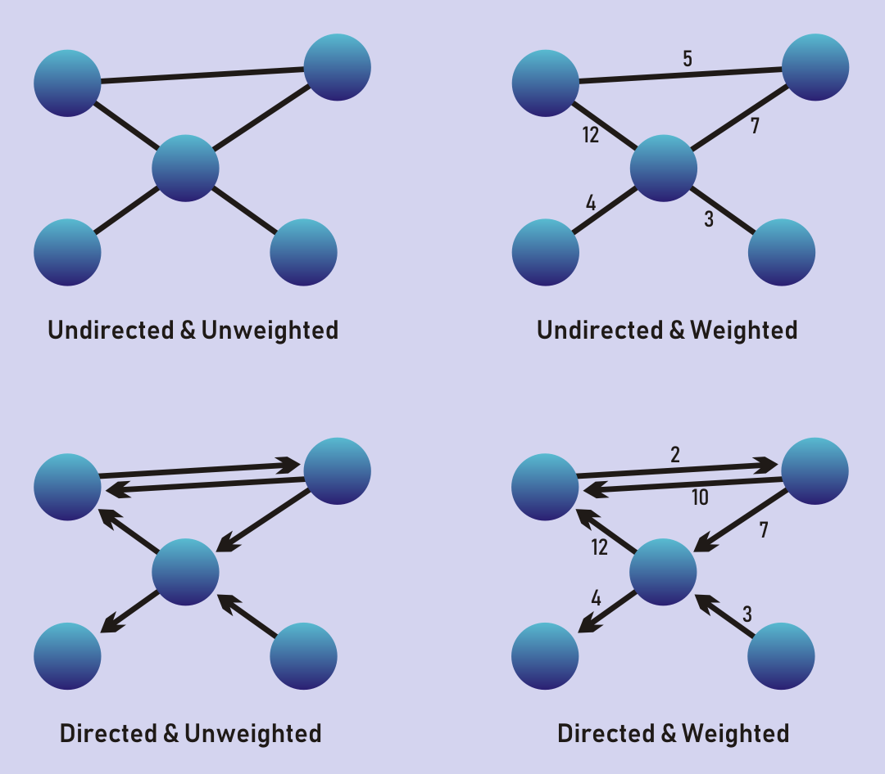
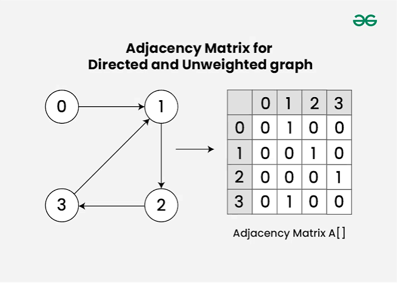
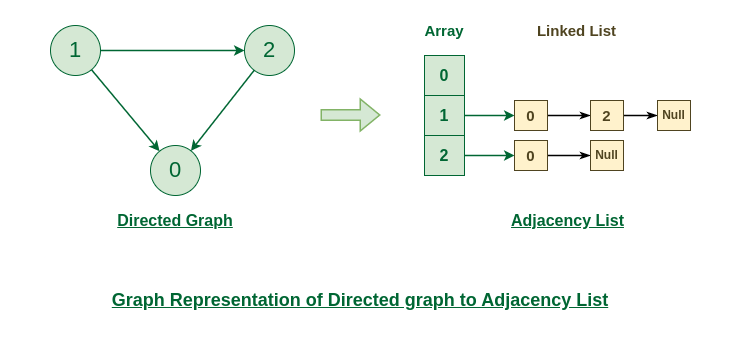
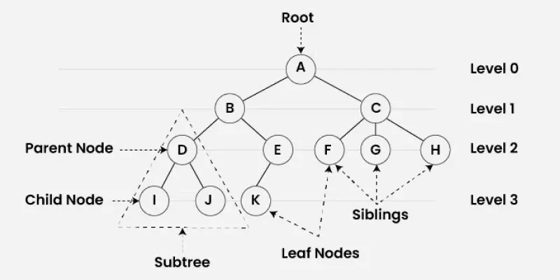
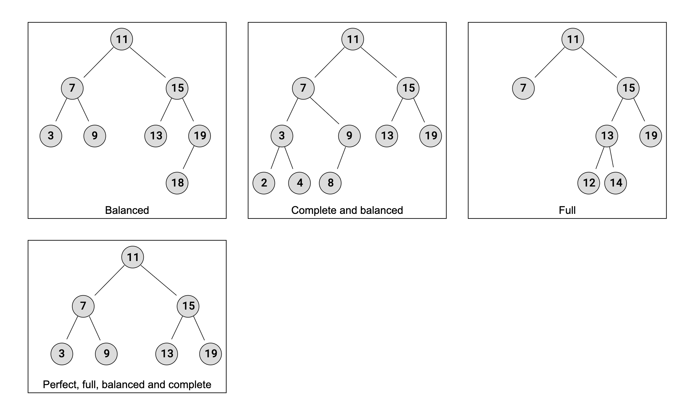
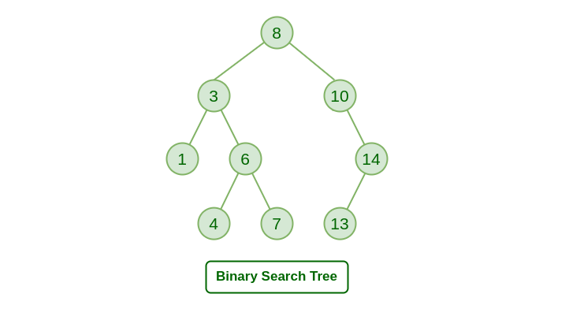
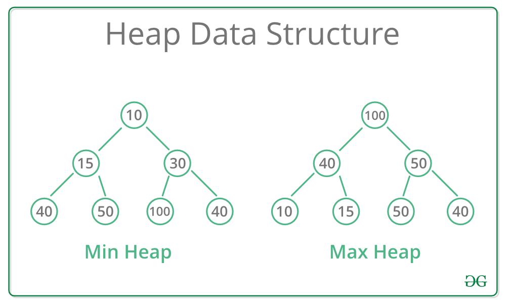

# Strings

```python
# ALL STRING METHODS DO NOT MUTATE!

"".join(['a', 'b', 'c']) # create a string from an iterable
' '.isalnum() # check if char is alphanumeric
'S'.lower() # converts char to lower
's'.upper() # converts char to upper
' hello \n '.strip() # strips any whitespace
"apple,banana,cherry".split(",") # returns list of strings at delimineter
"I love Java".replace("Java", "Python") # replaces a substring
"12345".isdigit()   # True  -> Digits only
"Letters".isalpha() # True  -> Letters only
"Abc12".isalnum()   # True  -> Alphanumeric (letters + digits)
"   ".isspace()    # True  -> Whitespace only
```

Output:

```
True
```


## Lists

Ordered, mutable, dynamic, collections

```python
l = [1, "apple", 3.4, 2, 3]
l.append(2)  # appends element to the end of the list
l.extend([1, 2]) # appends items from an iterable 

l.remove(1) # removes first occurance of a value
l.pop() # if provided an index it removes and returns the element at index i, else removes the last index
l.clear() # clears

l.reverse() # returns items in reverse order (done in place!)
l.sort() # sorts ( done in place!)
l.index() # returns the index of the first matched element

for item in l:
    print(item)

for i in range(len(l)): 
    print(l[i])

combo_list = l+ ["bannana"] # merge two lists
```

Output:

```
---------------------------------------------------------------------------
TypeError                                 Traceback (most recent call last)
Cell In[3], line 11
      9 l.reverse() # returns items in reverse order (done in place!)
     10 l.sort() # sorts ( done in place!)
---> 11 l.index() # returns the index of the first matched element
     13 for item in l:
     14     print(item)

TypeError: index expected at least 1 argument, got 0
```


## Tuples

Ordered, immutable, collections, allow duplicates

```python

tuple = (1, "apple", 3.4)
```


## Dictionaries(HASHMAP)

Unordered, mutable collections of key-value pairs

```python
dictionary = {"a": 1, "b": 2, "c": 3}

dictionary.keys() # ["a", "b", "c"]
dictionary.values() # [1, 2, 3]
dictionary.items() # [("a", 1), ("b", 2), ("c", 3)]

dictionary["d"] = 4 # adds a key value pair
dictionary.update({"a": 2,"e": 5}) # updates values and also adds new pairs

dictionary.pop('d') # removes a key pair with given key

if "d" in dictionary: # check if key exists
    print("d exists!")

# Array as value example
user_scores = {}

# "Push" a new key and its list value
user_scores["Alice"] = [85, 92]
user_scores["John"] = [44, 12]

print(user_scores)
# Output: {'Alice': [85, 92]}

# Convert dictionary values to a 2D list
scores_2d = list(user_scores.values())

print(scores_2d)
print(scores_2d)
```

Output:

```
{'Alice': [85, 92], 'John': [44, 12]}
[[85, 92], [44, 12]]
[[85, 92], [44, 12]]
```


## Sets

Unordered, mutable collections, unique

```python

set = {1, 2, 3, "apple"}

set.add(4) # adds an element
set.remove(1) # removes an element and returns key error if doesn't exist
set.discard(5) # removes an element but doesn't throw an error if it doesn't exist

set2 = {1, 2, 10}
set.union(set2) # returns the all unique elements from both sets
set.intersection(set2) # returns the intersection between two sets
set.difference(set2) # returns elements in set1 but not in set2
```

Output:

```
{3, 4, 'apple'}
```


## Linked Lists

Dynamically sized linear data structure consisting of Nodes linked together. 

- Head node points to the first node in the list
- Tail node points to the last node in the list (optional)

Each Node consists of -> 

- data: the value you want to store
- next: points to the next node in the list

Compared to arrays, Linked Lists insertion is O(1) but indexing is O(n). 

### Doubly Linked List

Nodes hold an additional prev pointer and can therefore be transversed in either direction(head <-> tail)

```python
class Node:
    def __init__(self, data):
        self.data = data 
        self.next = None

class LinkedList:
    def __init__(self):
        self.head = None  # The list starts out empty

    def append(self, data):
        """Adds a new node to the end of the list."""
        new_node = Node(data)
        
        # If the list is empty, make the new node the head
        if not self.head:
            self.head = new_node
            return
            
        # Otherwise, traverse to the last node
        current = self.head
        while current.next:
            current = current.next
            
        # Link the last node to the new node
        current.next = new_node

    def prepend(self, data):
        """Adds a new node to the beginning of the list."""
        new_node = Node(data)
        new_node.next = self.head  # Point new node to the current head
        self.head = new_node       # Make new node the new head

    def delete(self, key):
        """Deletes the first node that matches the given key."""
        current = self.head

        # Case 1: The head node itself holds the key to be deleted
        if current and current.data == key:
            self.head = current.next  # Changed head
            current = None            # Free memory
            return

        # Case 2: Search for the key to be deleted, keep track of the previous node
        prev = None
        while current and current.data != key:
            prev = current
            current = current.next

        # If key was not present in linked list
        if not current:
            print("Element not found.")
            return

        # Unlink the node from linked list
        prev.next = current.next
        current = None
```


## Queue

Mutatable linear data structure, FIFO

```python
from collections import deque

queue = deque(["1", "2", "3"]) # double ended queue

queue.append('4') # appends 
queue.popleft() # removes "1"
queue.pop() # removes 4

print(queue)
```

Output:

```
deque(['2', '3'])
```


### From Scratch - Python

Use an array. Add to the back, remove from the front

```python
class Queue: 
    def __init__(self): 
        self.queue = []
    def add(self, data):
        self.queue.append(data);
    def remove(self, data): 
        self.queue.pop(0);
```


## From Scratch - Typescript 
The lazy approach: Use array methods


``` typescript
class Queue {
    private queue: T[] = [];

    enqueue(item: T) {
        queue.push(item);
    }
    dequeu() {
        return queue.shift() 
    }
}
```

We can improve this from O(n) to O(1) by using a head index. 

```typescript
class Queue {
    private queue: T[] = [];
    private headIndex: number = 0; 

    enqueue(item: T) {
        queue.push(item);
    } 
    dequeue() {
        return queue[headIndex];
        i++; 
    }
}
```

## Stack

Mutable linear data stucture, LIFO
Use a list, treating treat last index as the top of the stack

- Do both pop and add at last index

```python
stack = [1]

stack.append(2)
stack.append(3)
print(stack[-1]) # 3

stack.pop() # removes 3 (end of the list)

print(stack)
```

Output:

```
3
[1, 2]
```


## Graph

Non-linear data structure consisting of: 

- Vertices/Nodes: entities or points
- Edges: connections between vertices

Graphs are flexible unlike other data structures and can represent any type of relationship between items.

Graphs can be **undirected**, connections go both ways, or **directed**, connections have direction.

Graphs can be **weighted**, edges have a value, or **unweighted**, all edges treated equally. 



## Graph Representations

### Adjacency Matrix


### Adjacency List



```python
"""
Adjancy List

Maps each vertex to a list of neighboring vertices.
"""

graph = {
    'A': ['B', 'C'],
    'B': ['A', 'D', 'E'],
    'C': ['A', 'F'],
    'D': ['B'],
    'E': ['B', 'F'],
    'F': ['C', 'E']
}

"""
Adjancy Matrix

2D grid where 1(or a weight value) indicates a connection between a row and column
"""

# Matrix order: [A, B, C]
# Row 0 is A, Row 1 is B, Row 2 is C
adjacency_matrix = [
    [0, 1, 1],  # A connects to B and C
    [1, 0, 0],  # B connects to A
    [1, 0, 0]   # C connects to A
]
```


## Tree

Hierarchical non linear data structure consisting of nodes and edges organized in a top-down fashion. Trees are a subset of Graphs. 

Structural Layout

- Root: The topmost node of the tree (the starting point). Every tree has exactly one root.
- Parent / Child: A node directly connected to another node moving downward is the parent. The nodes below it are its children.
- Leaf Node: A node that has no children (the absolute end of a branch).
- Subtree: Any node along with all of its descendants forms a mini-tree inside the larger tree.



```python
# Node structure for tree
class Node:
    def __init__(self, x):
        self.data = x
        self.children = []
class Tree: 
    def __init__(self, x):
        self.root = x;
    # Function to add a child to a node
    def addChild(parent, child):
        parent.children.append(child)
```


## Binary Tree

A Binary Tree is a type of tree data structure where each node can have a maximum of two child nodes, a left child node and a right child node.

### Types of Binary Trees

- A **balanced Binary Tree** has at most 1 in difference between its left and right subtree heights, for each node in the tree.
- A **complete Binary Tree** has all levels full of nodes, except the last level, which can be full, or filled from left to right. The properties of a complete Binary Tree means it is also balanced.
- A **full Binary Tree** is a kind of tree where each node has either 0 or 2 child nodes.
- A **perfect Binary Tree** has all leaf nodes on the same level, which means that all levels are full of nodes, and all internal nodes have two child nodes.The properties of a perfect Binary Tree means it is also full, balanced, and complete.



```python
# Binary Tree as Node class
class Node: 
    def __init__(self, value):
        self.value = value
        self.left = None
        self.right = None

root = Node(1)
left = Node(2)
right = Node(3)

root.left = left
root.right = right

# The tree looks like this:
#        1
#       / \
#      2   3

# Binary Tree as an array
```


### Binary Search Tree

A Binary Search Tree (BST) is a node-based binary tree data structure that follows a strict ordering rule:

- The left subtree of a node contains only nodes with keys less than the node’s key.
- The right subtree of a node contains only nodes with keys greater than the node’s key.
- Both the left and right subtrees must also be binary search trees.



```python
class Node:
    def __init__(self, value):
        self.value = value
        self.left = None
        self.right = None
        
class IterativeBinarySearchTree:
    def __init__(self):
        self.root = None

    # --- ITERATIVE INSERTION ---
    def insert(self, value):
        new_node = Node(value)
        #if root no created, make one
        if(self.root is None): 
            self.root = new_node
            return
        
        current = self.root
        while True:
            print('chck', current.value)
            # Go left
            if value < current.value: 
                # open spot!
                if current.left is None:
                    current.left = new_node
                    break
                # traverse down left
                current = current.left
            # Go right
            if value > current.value: 
                # open spot!
                if current.right is None:
                    current.right = new_node
                    break
                # traverse down right
                current = current.right 
            # ignore duplicates
            else:
                break

values = [4, 1, 3, 2, 5, 6, 7]
bst = IterativeBinarySearchTree()
for value in values:
    print(value)
    bst.insert(value);
```

Output:

```
4
1
chck 4
3
chck 4
2
chck 4
chck 3
5
chck 4
7
chck 4
chck 5
6
chck 4
chck 5
chck 7
```


## Heap

A Heap is a **complete binary tree** data structure that satisfies the heap property -> 

1. **min-heap**: The value of each child is greater than or equal to its parent
2. **max-heap**: The value of each child is less than or equal to its parent

Heaps are commonly used to create Priority Queues or finding the K-largest elements.



## Built in method

```python
import heapq

# MIN-HEAP
# 1. Create a heap from an unsorted list
data = [5, 1, 8, 3, 2]
heapq.heapify(data)  # Modifies the list in-place
print("Heapified list:", data) 
# Output will be arranged as a min-heap structure, e.g., [1, 2, 8, 3, 5]

# 2. Push a new element
heapq.heappush(data, 0)
print("After push:", data)

# 3. Pop the smallest element
smallest = heapq.heappop(data)
print("Popped item:", smallest)  # Output: 0
print("Remaining heap:", data)

# MAX-HEAP
max_heap = []
numbers = [5, 1, 8, 3, 2]

# Push elements as negative numbers
for num in numbers:
    heapq.heappush(max_heap, -num)

# When you pop, multiply by -1 again to get the original number
largest = -heapq.heappop(max_heap)
print("Largest item:", largest)  # Output: 8
```

Output:

```
Heapified list: [1, 2, 8, 3, 5]
After push: [0, 2, 1, 3, 5, 8]
Popped item: 0
Remaining heap: [1, 2, 8, 3, 5]
Largest item: 8
```


## Priority Queue

Each element is served in FIFO order based on their assigned priority.

```python
"""
Built in version using heap. Other datastructures can be used. 
"""
import heapq

# Initialize an empty list to act as our priority queue
pq = []

# Insert items with (priority, task_name)
heapq.heappush(pq, (3, "Low priority task"))
heapq.heappush(pq, (1, "Critical bug fix"))
heapq.heappush(pq, (2, "Feature development"))

# Pop items - they will come out in order of lowest priority number to highest
while pq:
    priority, task = heapq.heappop(pq)
    print(f"Processing: {task} (Priority: {priority})")


"""
Handling tie-breakers
By default, the alphabetical order of the string will be used but you can use a monotonic counter
"""
pq = []
counter = 0  # Serves as a unique, incrementing tie-breaker

# Task A and Task B have the same priority (2)
# Task A is added first, so its counter will be lower

# Push Task A
heapq.heappush(pq, (2, counter, "Task A"))
counter += 1

# Push Task C (Higher priority)
heapq.heappush(pq, (1, counter, "Task C"))
counter += 1

# Push Task B (Same priority as A)
heapq.heappush(pq, (2, counter, "Task B"))
counter += 1

# Pop and process
while pq:
    priority, count, task = heapq.heappop(pq)
    print(f"Processing: {task}")
```

Output:

```
Processing: Critical bug fix (Priority: 1)
Processing: Feature development (Priority: 2)
Processing: Low priority task (Priority: 3)
Processing: Task C
Processing: Task A
Processing: Task B
```


### From Scratch using a list

The Index math for any node located at index i:

- Left Child Index: `2i + 1`
- Right Child Index: `2i + 2`
- Parent Index: `(i - 1) / 2`

```python
class MinHeap:
    def __init__(self):
        self.heap = []

    def get_parent_index(self, i):
        return (i - 1) // 2

    def get_left_child_index(self, i):
        return (2 * i) + 1

    def get_right_child_index(self, i):
        return (2 * i) + 2

    def has_parent(self, i):
        return self.get_parent_index(i) >= 0

    def has_left_child(self, i):
        return self.get_left_child_index(i) < len(self.heap)

    def has_right_child(self, i):
        return self.get_right_child_index(i) < len(self.heap)

    def swap(self, i, j):
        self.heap[i], self.heap[j] = self.heap[j], self.heap[i]

    def peek(self):
        """Look at the minimum element without removing it."""
        if len(self.heap) == 0:
            return None
        return self.heap[0]

    def insert(self, key):
        """Adds an element to the heap. Time Complexity: O(log N)"""
        self.heap.append(key)          # Add to the very end
        self.heapify_up(len(self.heap) - 1)  # Fix the heap property

    def extract_min(self):
        """Removes and returns the minimum element. Time Complexity: O(log N)"""
        if len(self.heap) == 0:
            raise IndexError("Extract from empty heap")
        
        min_item = self.heap[0]
        
        # Move the last element to the root
        last_item = self.heap.pop()
        if len(self.heap) > 0:
            self.heap[0] = last_item
            self.heapify_down(0)  # Fix the heap property
            
        return min_item

    def heapify_up(self, index):
        """Bubbles an element up until the heap property is restored."""
        while (self.has_parent(index) and 
               self.heap[index] < self.heap[self.get_parent_index(index)]):
            parent_idx = self.get_parent_index(index)
            self.swap(index, parent_idx)
            index = parent_idx

    def heapify_down(self, index):
        """Sinks an element down until the heap property is restored."""
        while self.has_left_child(index):
            smaller_child_index = self.get_left_child_index(index)
            
            # If right child exists and is smaller than left child, use it instead
            if (self.has_right_child(index) and 
                self.heap[self.get_right_child_index(index)] < self.heap[smaller_child_index]):
                smaller_child_index = self.get_right_child_index(index)
                
            # If the current element is smaller than its smallest child, we're done
            if self.heap[index] < self.heap[smaller_child_index]:
                break
            else:
                self.swap(index, smaller_child_index)
                
            index = smaller_child_index
```

